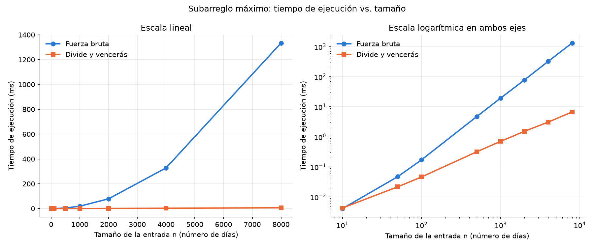

# Laboratorio 2 — Divide y vencerás: subarreglo máximo

**Autor:** Samuel Quiroz Rincón

**Grupo:** 190304006-1 (Asincrónico)

## Cómo reproducir el experimento

Desde la raíz del repositorio, active el entorno virtual e instale las
dependencias:

```bash
# Linux / macOS
source .venv/bin/activate

# Windows (PowerShell)
.venv\Scripts\Activate.ps1

pip install -r requirements.txt
```

Luego entre a la carpeta del laboratorio y ejecute:

```bash
cd lab2-divide-y-vencer

# Pruebas: al terminar imprime "Todas las pruebas pasaron."
python pruebas.py

# Medición: imprime la tabla de tiempos y guarda graficas/tiempo_vs_n.png
python medicion.py
```

La semilla fija hace que los datos sean siempre los mismos; los tiempos sí
cambian de un equipo a otro, pero la forma de las curvas se mantiene.

## Parte 1 — Implementación y verificación

Código: [subarreglo.py](subarreglo.py) · Pruebas: [pruebas.py](pruebas.py)

`pruebas.py` es un script con `assert` que compara la **suma** que devuelve
cada algoritmo (no los índices, porque puede haber varios tramos con la misma
suma). Además comprueba que los índices devueltos realmente sumen ese valor y
que la lista recibida no cambie. Casos cubiertos:

- La serie de ocho días de la situación problema (suma 17).
- Series de un solo elemento, positivo y negativo.
- Todos los valores negativos (la respuesta es el día menos malo).
- Todos los valores positivos (la respuesta es la serie completa).
- Un caso donde el mejor tramo cruza el punto medio, verificando también
  `suma_cruzada` directamente.
- Casos donde el mejor tramo queda completo en la mitad izquierda o derecha.
- 200 listas aleatorias (semilla fija, entre 1 y 60 elementos) en las que
  ambas funciones deben dar la misma suma.

## Parte 2 — Medición y gráfica

Código: [medicion.py](medicion.py)



Cómo se midió:

- Tamaños: 10, 50, 100, 500, 1000, 2000, 4000 y 8000.
- Datos enteros entre -100 y 100 generados con semilla fija (2026); en cada
  tamaño ambos algoritmos reciben la misma lista.
- Solo se cronometra la llamada al algoritmo con `time.perf_counter()`; la
  generación de los datos queda por fuera.
- Cada medición se repite 5 veces y se conserva el menor tiempo, que es el
  menos afectado por otros procesos del equipo.
- En cada tamaño un `assert` verifica que ambos algoritmos dan la misma suma.
- El panel izquierdo de la gráfica está en escala lineal y el derecho en
  escala logarítmica, para poder ver también los tamaños pequeños.

Tiempos medidos en mi equipo:

| n    | Fuerza bruta (ms) | Divide y vencerás (ms) |
|-----:|------------------:|-----------------------:|
| 10   |            0.0041 |                 0.0043 |
| 50   |            0.0474 |                 0.0218 |
| 100  |            0.1724 |                 0.0464 |
| 500  |            4.7659 |                 0.3202 |
| 1000 |           19.5975 |                 0.7111 |
| 2000 |           78.9639 |                 1.5358 |
| 4000 |          328.0061 |                 3.1213 |
| 8000 |         1333.7090 |                 6.7479 |

## Parte 3 — Análisis

### 1. Recurrencia

La función `subarreglo_maximo` divide el rango por la mitad y hace **dos**
llamadas recursivas, cada una sobre n/2 elementos. Después `suma_cruzada`
busca el mejor tramo que cruza el medio barriendo una sola vez hacia cada
extremo, lo que cuesta Θ(n), mientras que calcular el medio y comparar los
tres candidatos agrega Θ(1). De ahí sale la recurrencia:

```text
T(n) = 2·T(n/2) + Θ(n),   T(1) = Θ(1)
```

En el método maestro, a = 2, b = 2 y f(n) = Θ(n), que se compara con
n^(log₂ 2) = n. Como f(n) es exactamente de ese mismo orden, se cumple la
condición del caso 2 y T(n) = Θ(n log n).

La fuerza bruta fija cada inicio i y avanza el final j desde i
hasta n − 1, agregando en cada paso un elemento a la suma acumulada en Θ(1).
El ciclo interno se ejecuta n(n + 1)/2 veces, y por eso es Θ(n²).

### 2. Lo medido contra lo esperado

En el panel lineal de la gráfica, la curva de fuerza bruta se dispara como una
parábola cuando n crece, mientras que la de divide y vencerás permanece pegada
al eje, en n = 8000 tardan 1333.71 ms y 6.75 ms, casi 200 veces menos. En el
panel logarítmico ambas son casi rectas, pero la pendiente de la fuerza bruta
es cercana a 2 y la de divide y vencerás a 1.1, por lo que la distancia entre
ellas aumenta con n.

Al duplicar n de 4000 a 8000, la fuerza bruta pasó de 328.01 ms a 1333.71 ms,
un factor de 4.07 frente al 2² = 4 que predice Θ(n²). Divide y vencerás pasó
de 3.12 ms a 6.75 ms, un factor de 2.16 frente al
2 · log 8000 / log 4000 ≈ 2.17 que predice Θ(n log n); ambos coinciden con lo
esperado.

### 3. Tamaños pequeños

En n = 10 los dos empatan (0.0041 ms contra 0.0043 ms, dentro del ruido de
medición), pero en n = 50 divide y vencerás ya es 2.2 veces más rápido y desde ahí
su ventaja solo crece; el cruce está entre 10 y 50 elementos, aunque no puedo
ubicarlo mejor porque no medí tamaños intermedios. Que no gane desde el inicio
se debe al costo fijo de cada llamada recursiva (crear el marco, calcular el
medio, armar y comparar tuplas), mientras que con n = 10 la fuerza bruta
termina en 55 iteraciones.

### 4. ¿Cuándo conviene dividir?

Al dividir a la mitad el problema del máximo se obtienen dos subproblemas de
tamaño n/2 y combinar es una sola comparación, así que la recurrencia es
T(n) = 2·T(n/2) + Θ(1). Como f(n) = Θ(1) es polinómicamente menor que n,
aplica el caso 1 del método maestro y T(n) = Θ(n). Es el mismo orden que
recorrer el arreglo una vez, pero con el costo extra de las llamadas
recursivas. Por tanto no mejora, ni podría hacerlo, porque hay que mirar cada
número al menos una vez. Dividir conviene cuando combinar cuesta menos que
resolver directamente, en el subarreglo máximo se combina en Θ(n) frente a un
Θ(n²) directo, mientras que en el máximo no hay nada que ahorrar.

### 5. Concepto para la gerente

Recomiendo divide y vencerás, ya que con los 2000 días actuales ya son 1.5 ms
contra 79 ms por tienda, unos 2.3 segundos contra casi 2 minutos para las 1500
tiendas, y con las series de sensores la fuerza bruta deja de ser viable.

Para un millón de registros no tengo una medición sino una estimación,
extrapolada desde n = 8000 (125 veces menor) sin regla de tres lineal, porque
ningún tiempo crece en proporción a n. El de fuerza bruta crece con n², así
que se multiplica por 125² = 15 625 y pasa de 1.334 s a unos 20 800 s, cerca
de 5.8 horas. El de divide y vencerás crece con n log n, por lo que el
factor es 125 × (log₂ 10⁶ / log₂ 8000) ≈ 192, y 6.75 ms se convierten en unos
1.3 segundos. Esto supone que la constante medida en mi equipo se
mantiene; aun así, la diferencia es de horas contra segundos.
