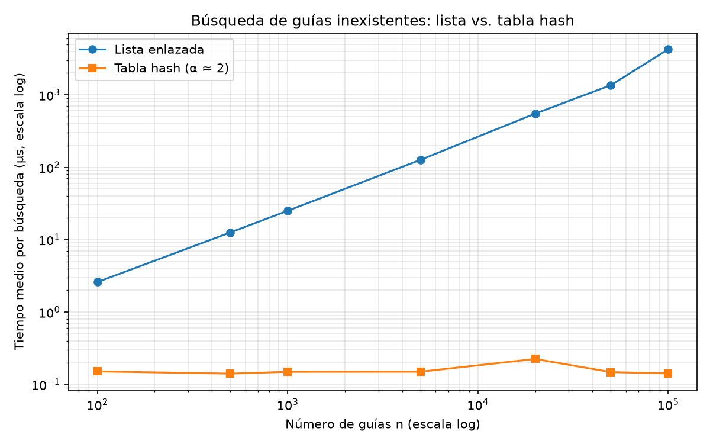
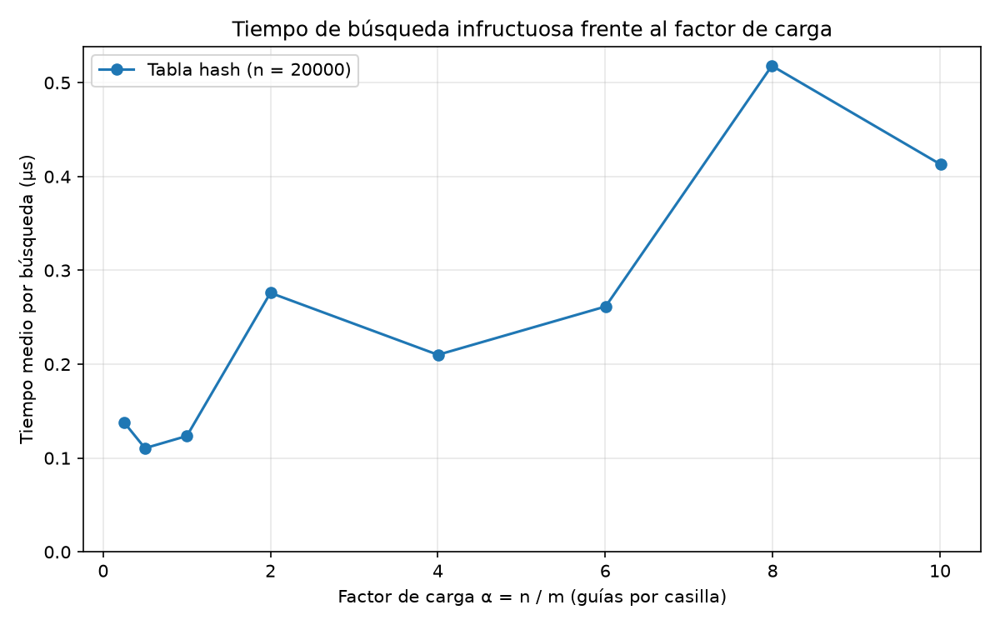

# Laboratorio 3 — Estructuras de datos

**Autor:** Samuel Quiroz Rincón

**Grupo:** 190304006-1 (Asincrónico)

Rutas del Caribe: reemplazo de la lista enlazada de envíos por una tabla hash
con encadenamiento, y medición de cuánto mejora la consulta.

## Cómo reproducir

Desde la raíz del repositorio `curso-analisis-algoritmos-samuelquiroz`:

```bash
# Activar el entorno virtual (matplotlib ya está en requirements.txt)
source venv/bin/activate          # Linux / macOS
# venv\Scripts\activate           # Windows

pip install -r requirements.txt    # solo si falta alguna dependencia

cd lab3-estructuras-datos
python pruebas.py                  # imprime "Todas las pruebas pasaron."
python medicion.py                 # imprime las tablas y regenera graficas/
```

La medición completa tarda menos de 15 segundos. Las guías se generan con
semilla fija (2026) y las inexistentes con la semilla 7, así que los datos son
reproducibles; los tiempos absolutos dependen de la máquina.

---

## Parte 1 — Implementación y verificación

Código: [estructuras.py](estructuras.py) · [pruebas.py](pruebas.py)

- `ListaEnlazada.insertar` crea un nodo y lo pone como nueva cabeza (Θ(1));
  `buscar` recorre con un `while` hasta encontrar la guía o llegar a `None`.
- `TablaHash` usa `h(k) = k mod m` y una `ListaEnlazada` por casilla. Insertar
  y buscar solo tocan la lista de la casilla `h(k)`; no se usa `dict`, `set`
  ni `hash()` de Python.

Casos que cubre `pruebas.py`:

1. Serie de ejemplo del enunciado: búsquedas exitosas e infructuosas en la
   lista y en la tabla, y que la cabeza de la lista es la última guía insertada.
2. Estructuras vacías: buscar devuelve `None` y α = 0.
3. Colisión forzada con `m = 7`: se comprueba que 10, 24 y 17 dan `hash = 3`,
   que la casilla 3 tiene longitud 3 y las demás están vacías, que las tres se
   encuentran después, y que 31 (que también cae en la casilla 3 pero no
   existe) devuelve `None`. Luego `factor_carga() == 3 / 7`.
4. Que `hash` siempre devuelve un índice entre 0 y m − 1.
5. 25 colecciones aleatorias (n entre 1 y 300, m entre 1 y 101, incluido
   `m = 1`, donde todo colisiona): para cada guía existente lista y tabla
   devuelven el mismo estado, y para 50 guías inexistentes ambas devuelven
   `None`.

---

## Parte 2 — Medición

Código: [medicion.py](medicion.py)

Para cada configuración se construyen la lista y la tabla
con las mismas guías (fuera del cronómetro) y se verifica que devuelven el
mismo estado para una muestra de unas 100 guías existentes. Luego se
cronometran con `time.perf_counter()` 200 búsquedas de guías inexistentes.
Primero una pasada de calentamiento sin cronometrar y después 5 repeticiones
del lote de 200, se reporta la mediana del tiempo medio por búsqueda.
En cada n la tabla usa un m primo cercano a n/2 (α ≈ 2).

### Experimento A — lista frente a tabla (α ≈ 2)

Salida de `python medicion.py`:

```text
Experimento A: lista frente a tabla (200 guias inexistentes)
       n       m   alfa   lista (us)  tabla (us)
     100      47   2.13        2.596       0.152
     500     251   1.99       12.592       0.141
    1000     499   2.00       25.038       0.149
    5000    2503   2.00      126.949       0.150
   20000   10007   2.00      550.447       0.225
   50000   24989   2.00     1361.949       0.148
  100000   49999   2.00     4250.566       0.142
```



Ambos ejes están en escala logarítmica porque n abarca tres órdenes de
magnitud: una recta de pendiente 1 indica crecimiento lineal y una horizontal,
tiempo constante.

Cuánto se multiplica el tiempo entre valores consecutivos de n:

| n anterior → n | n × | Lista × | Tabla × | Lista por nodo (ns) |
|---|---:|---:|---:|---:|
| 100 → 500 | 5,0 | 4,85 | 0,93 | 25,2 |
| 500 → 1 000 | 2,0 | 1,99 | 1,06 | 25,0 |
| 1 000 → 5 000 | 5,0 | 5,07 | 1,01 | 25,4 |
| 5 000 → 20 000 | 4,0 | 4,34 | 1,50 | 27,5 |
| 20 000 → 50 000 | 2,5 | 2,47 | 0,66 | 27,2 |
| 50 000 → 100 000 | 2,0 | 3,12 | 0,96 | 42,5 |

De la gráfica se entiende:

- La lista sube como una recta: el factor de la lista sigue al de n y el costo
  por nodo se queda en unos 25–27 ns hasta n = 50 000.
- En el último tramo (50 000 → 100 000) la lista crece ×3,12 en lugar de ×2:
  el costo por nodo salta a 42,5 ns. Lo más probable es que 100 000 nodos
  dispersos ya no quepan en la memoria caché del procesador y cada salto a
  siguiente sea más lento. La forma sigue siendo lineal, pero con una
  constante mayor.
- La tabla queda plana entre 0,14 y 0,15 µs. El único punto que se sale es
  n = 20 000 (0,225 µs), que se atribuye a ruido del sistema en esa corrida:
  el punto siguiente vuelve a 0,148 µs.
- Con n = 100 000 la búsqueda infructuosa en la tabla es unas 30 000 veces
  más rápida que en la lista (4 250 µs frente a 0,142 µs).

### Experimento B — efecto del factor de carga (n = 20 000)

Salida de `python medicion.py`:

```text
Experimento B: efecto de alfa con n = 20000
alfa obj.       m alfa real  tabla (us)
     0.25   79999     0.250       0.138
     0.50   40009     0.500       0.111
     1.00   19997     1.000       0.124
     2.00   10007     1.999       0.276
     4.00    4999     4.001       0.210
     6.00    3331     6.004       0.262
     8.00    2503     7.990       0.518
    10.00    1999    10.005       0.413
```



De la gráfica se entiende:

- La tendencia es creciente: con α ≤ 1 el tiempo está alrededor de 0,12 µs y
  con α entre 8 y 10 alrededor de 0,47 µs, casi cuatro veces más.
- La curva no es monótona: α = 2 (0,276 µs) queda por encima de α = 4
  (0,210 µs), y α = 8 (0,518 µs) por encima de α = 10 (0,413 µs). Son tiempos
  de décimas de microsegundo, del mismo tamaño que las variaciones del sistema
  operativo, así que cada punto individual tiene bastante ruido.
- Ajustando una recta por mínimos cuadrados a los ocho puntos se obtiene
  t ≈ 0,119 + 0,035·α µs: unos 0,12 µs fijos (calcular `k mod m` y llegar
  a la casilla) más unos 0,035 µs por cada guía extra en la cadena.

---

## Parte 3 — Análisis

### 1. Costo teórico

En la lista no ordenada, para concluir que una guía no existe hay que compararla con los `n` nodos, cada comparación a costo constante: `Θ(n)`. En la tabla, calcular `k mod m` y acceder a la casilla cuesta `Θ(1)`, y después solo se recorre su cadena. Bajo el supuesto de hashing uniforme simple (cada guía cae en cualquier casilla con igual probabilidad e independientemente de las demás), la cadena mide en promedio `n/m = α`, así que la búsqueda fallida cuesta `Θ(1 + α)`. Si todas las guías cayeran en la misma casilla, la tabla sería una sola lista de `n` nodos y volvería a costar `Θ(n)`.

### 2. Lo medido contra lo esperado

En la gráfica 1, al pasar de `n = 500` a `n = 1 000`, la lista va de 12,59 a 25,04 µs (×1,99), lo que coincide con `Θ(n)`, y la tabla va de 0,141 a 0,149 µs (×1,06), prácticamente constante como predice `Θ(1)` con `α ≈ 2`. Entre 50 000 y 100 000 la lista crece ×3,12, sigue siendo lineal. Pero cada nodo cuesta más porque la lista ya no cabe en caché. En la gráfica 2 el tiempo sube de ≈ 0,12 µs (`α ≤ 1`) a ≈ 0,47 µs (`α ≈ 10`) y se ajusta a `t ≈ 0,119 + 0,035·α`, justo la forma `c₀ + c₁·α` de `Θ(1 + α)`, un término fijo que no desaparece más uno que crece con la cadena.

### 3. Colisiones

Una colisión ocurre cuando dos guías distintas tienen el mismo hash; con `m = 7`, 10, 24 y 17 caen en la casilla 3. Ocurren aunque haya más casillas que guías porque el hash reparte casi al azar (paradoja del cumpleaños: con 365 casillas bastan 23 claves para que una colisión sea lo más probable). El encadenamiento, que implementamos, guarda en cada casilla una lista (`17 → 24 → 10`), nunca se llena y admite `α > 1`, a costa de memoria para punteros. El direccionamiento abierto prueba la siguiente casilla libre (10 → 3, 24 → 4, 17 → 5), no usa punteros y aprovecha mejor la caché, pero exige `α < 1`, se degrada al acercarse a 1 y complica el borrado.

### 4. Tabla hash o árbol de búsqueda

La tabla no sirve para "guías entre X y Y". `k mod m` destruye el orden y obliga a revisar las `n` guías. Un ABB sí lo conserva, se baja hasta X y se recorre en orden hasta Y, en `O(h + k)`, con `k` las guías reportadas. Pero si las 400 000 guías se insertaran ya ordenadas, cada una iría a la derecha de la anterior y el árbol degeneraría en una lista de altura ≈ 400 000, con ≈ 400 000 comparaciones por búsqueda. Un árbol equilibrado (AVL o rojinegro) tendría altura ≈ log₂ 400 000 ≈ 19, unas 20 000 veces menos comparaciones.

### 5. Concepto para la jefa de operaciones

Las dos necesidades de la empresa piden cosas distintas: el call center busca una guía exacta, mientras que el monitoreo necesita recorrer intervalos en orden. Como ninguna estructura resuelve bien ambas, se recomienda combinar dos. Una tabla hash con encadenamiento atendería las consultas puntuales, manteniendo `α` entre 1 y 2 mediante un redimensionamiento a un primo cercano a `n` cada vez que supere 2. Un árbol de búsqueda equilibrado (AVL o rojinegro) atendería las consultas por rango. Cada guía nueva se insertaría en ambas estructuras, lo que aumenta el uso de memoria, pero a cambio cada consulta se resuelve con la estructura que le corresponde.

Para estimar cuánto tardaría buscar una guía inexistente con 5 000 000 de envíos no basta una regla de tres. Primero hay que identificar la forma de cada curva medida y extrapolar según ella. Las cifras que siguen son, por tanto, una estimación y no una medición.

En la lista, la gráfica 1 muestra una relación lineal, de modo que el tiempo es `n` multiplicado por el costo de visitar un nodo. Con el costo observado hasta 50 000 guías, de unos 27 ns por nodo, la búsqueda tardaría unos 135 ms. Sin embargo, con 100 000 guías el costo ya sube a unos 42,5 ns por nodo, porque la lista deja de caber en la caché. Usando ese valor, la estimación es de aproximadamente **210 ms por consulta**. Con 5 millones de nodos la caché ayudará todavía menos, así que esa cifra debe entenderse como un mínimo.

En la tabla, en cambio, la gráfica 1 es plana entre `n = 100` y `n = 100 000`, lo que indica que el tiempo depende de `α` y no de `n`. Si `α` se mantiene cerca de 2, la búsqueda seguiría costando unos **0,15 µs**, quizá algo más por el efecto de la caché. Si la tabla no se redimensionara y conservara `m = 49 999`, el factor de carga llegaría a `α ≈ 100`. En ese caso, la recta de la gráfica 2 predice 0,119 + 0,035 × 100 ≈ **3,6 µs**: sigue siendo rápido, pero muestra por qué conviene redimensionar.

Como estas cifras provienen de mediciones en una sola máquina, solo deben tomarse como orden de magnitud. Aun así, la diferencia es clara: cientos de milisegundos para la lista frente a fracciones de microsegundo para la tabla.